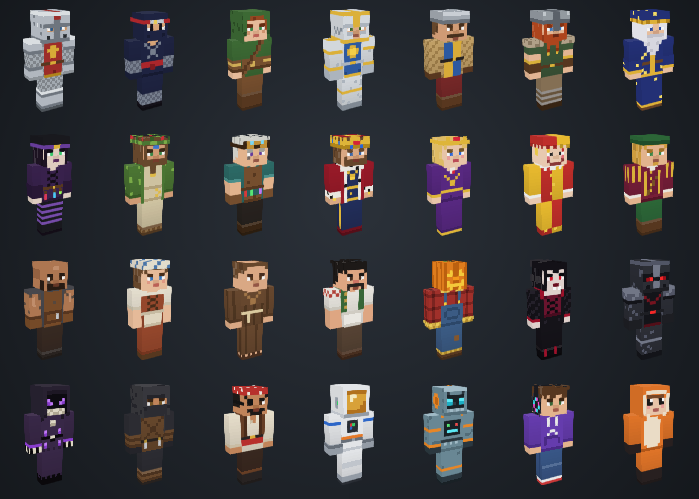

# Forja de Skins

Editor de skins para **Minecraft: Java Edition** que roda direto no navegador, com prévia 3D e um acervo de 28 skins originais, a maioria com tema medieval.



## O que dá para fazer

- **Pintar no boneco 3D** ou na **textura 64 × 64**. Clicar no boneco pinta; arrastar o fundo gira a câmera.
- Ferramentas: lápis, borracha, balde (com Shift troca a cor na skin inteira), conta-gotas, clarear, escurecer e ruído.
- **Simetria**: o que você pinta num braço ou perna se repete no outro.
- Escolher em qual camada pintar no 3D (base ou externa) e esconder a camada externa para ver o que está por baixo.
- Modelos **Clássico** (braços de 4 px) e **Slim** (3 px), animações de prévia e vistas de frente, costas e lados.
- Paletas com tinturas heráldicas, metais, couro, tecidos, tons de pele e cabelo, mais as 9 cores recentes (teclas 1 a 9).
- **Importar PNG** (64 × 64 ou o formato antigo 64 × 32, convertido na hora) e **Baixar PNG** pronto para o launcher.
- **Minhas skins**: salve suas criações no navegador. O rascunho atual também fica guardado.
- Desfazer e refazer (Ctrl+Z / Ctrl+Shift+Z).

## Acervo

23 skins medievais e 5 extras. Todas foram desenhadas para este projeto, pixel a pixel em código (`js/skins.js`), e estão em domínio público (CC0). Os arquivos PNG ficam na pasta [`skins/`](skins).

| Skin | Categoria | Modelo | Arquivo |
|---|---|---|---|
| Cavaleira de Ferro | Guerreiros | Clássico | [`cavaleira-de-ferro.png`](skins/cavaleira-de-ferro.png) |
| Ninja da Lua | Guerreiros | Clássico | [`ninja-da-lua.png`](skins/ninja-da-lua.png) |
| Arqueira da Mata | Guerreiros | Slim | [`arqueira-da-mata.png`](skins/arqueira-da-mata.png) |
| Paladino Dourado | Guerreiros | Clássico | [`paladino-dourado.png`](skins/paladino-dourado.png) |
| Guarda do Castelo | Guerreiros | Clássico | [`guarda-do-castelo.png`](skins/guarda-do-castelo.png) |
| Viking do Norte | Guerreiros | Clássico | [`viking-do-norte.png`](skins/viking-do-norte.png) |
| Mago Estelar | Magia | Clássico | [`mago-estelar.png`](skins/mago-estelar.png) |
| Bruxa do Pântano | Magia | Slim | [`bruxa-do-pantano.png`](skins/bruxa-do-pantano.png) |
| Druida do Carvalho | Magia | Clássico | [`druida-do-carvalho.png`](skins/druida-do-carvalho.png) |
| Alquimista | Magia | Clássico | [`alquimista.png`](skins/alquimista.png) |
| Rei Aurélio | Realeza | Clássico | [`rei-aurelio.png`](skins/rei-aurelio.png) |
| Rainha Isolda | Realeza | Slim | [`rainha-isolda.png`](skins/rainha-isolda.png) |
| Bobo da Corte | Realeza | Clássico | [`bobo-da-corte.png`](skins/bobo-da-corte.png) |
| Bardo Andarilho | Realeza | Clássico | [`bardo-andarilho.png`](skins/bardo-andarilho.png) |
| Ferreiro da Vila | Povo | Clássico | [`ferreiro-da-vila.png`](skins/ferreiro-da-vila.png) |
| Camponesa | Povo | Slim | [`camponesa.png`](skins/camponesa.png) |
| Irmão Bento | Povo | Clássico | [`irmao-bento.png`](skins/irmao-bento.png) |
| Taberneiro Bruno | Povo | Clássico | [`taberneiro-bruno.png`](skins/taberneiro-bruno.png) |
| Cabeça de Abóbora | Sombras | Clássico | [`cabeca-de-abobora.png`](skins/cabeca-de-abobora.png) |
| Condessa Vampira | Sombras | Slim | [`condessa-vampira.png`](skins/condessa-vampira.png) |
| Cavaleiro Negro | Sombras | Clássico | [`cavaleiro-negro.png`](skins/cavaleiro-negro.png) |
| Necromante | Sombras | Clássico | [`necromante.png`](skins/necromante.png) |
| Ladino Encapuzado | Sombras | Clássico | [`ladino-encapuzado.png`](skins/ladino-encapuzado.png) |
| Pirata Coral | Extras | Clássico | [`pirata-coral.png`](skins/pirata-coral.png) |
| Astronauta Órbita | Extras | Clássico | [`astronauta-orbita.png`](skins/astronauta-orbita.png) |
| Robô R-07 | Extras | Clássico | [`robo-r-07.png`](skins/robo-r-07.png) |
| Gamer de Moletom | Extras | Clássico | [`gamer-de-moletom.png`](skins/gamer-de-moletom.png) |
| Pijama de Raposa | Extras | Clássico | [`pijama-de-raposa.png`](skins/pijama-de-raposa.png) |

## Como usar a skin no jogo

1. No site, clique em **Baixar PNG**.
2. Abra o Minecraft Launcher, escolha *Minecraft: Java Edition* e vá na aba **Skins**.
3. Clique em **Nova skin**, selecione o arquivo e marque o modelo (Clássico ou Slim).
4. Salve. A skin vale no próximo mundo que você abrir.

## Rodar localmente

É um site estático, sem etapa de build. Abra o `index.html` no navegador ou sirva a pasta:

```bash
python3 -m http.server 8000
# depois acesse http://localhost:8000
```

A prévia 3D usa a biblioteca [skinview3d](https://github.com/bs-community/skinview3d) (MIT), carregada da CDN jsDelivr. Sem internet, o editor 2D continua funcionando.

## Publicar no GitHub Pages

1. No repositório, abra **Settings → Pages**.
2. Em *Build and deployment*, escolha **Deploy from a branch**, branch `main`, pasta `/ (root)`.
3. Salve. Em alguns minutos o site fica em `https://matheulb.github.io/Skins-Mine/`.

## Estrutura

```
index.html        página
css/estilo.css    visual (tema claro e escuro)
js/skins.js       geometria da skin e o acervo desenhado em código
js/app.js         editor, prévia 3D, acervo e downloads
skins/            PNGs do acervo
docs/acervo.png   prévia do acervo
```

## Aviso

Minecraft é marca da Mojang Studios. Este projeto não é oficial nem afiliado à Mojang ou à Microsoft.
